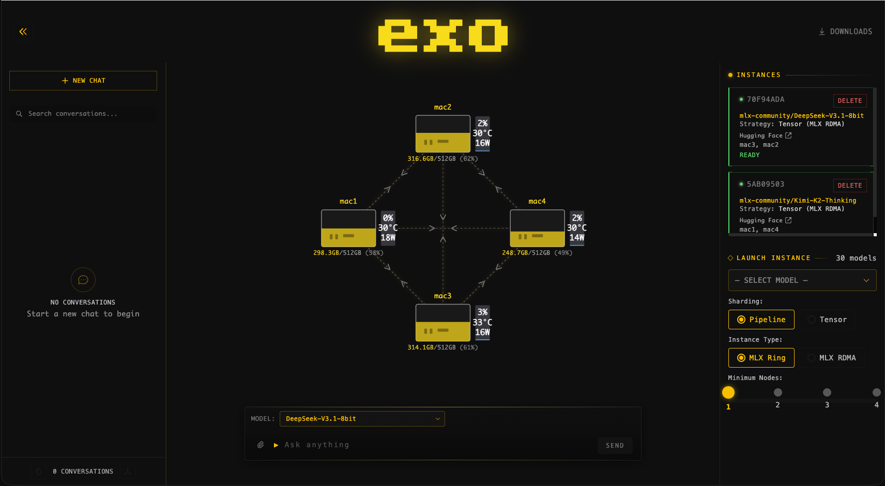
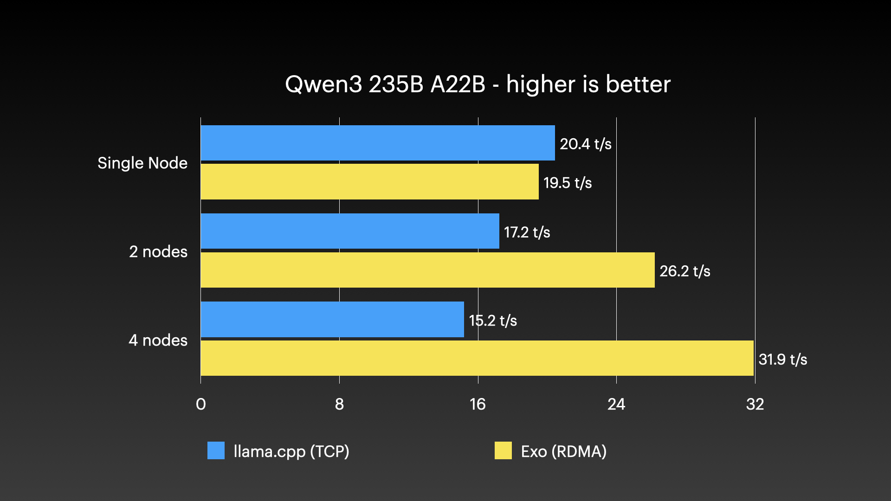
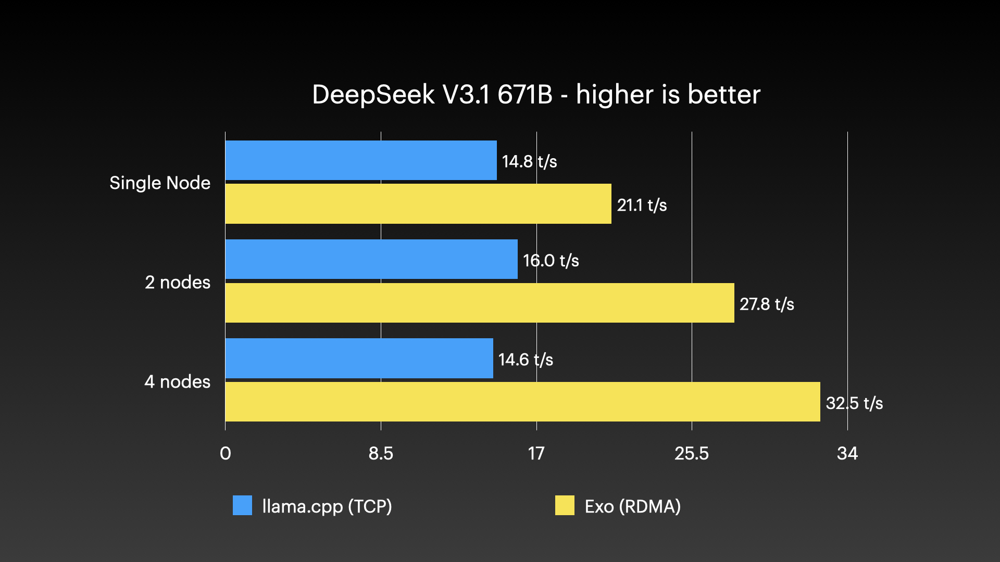
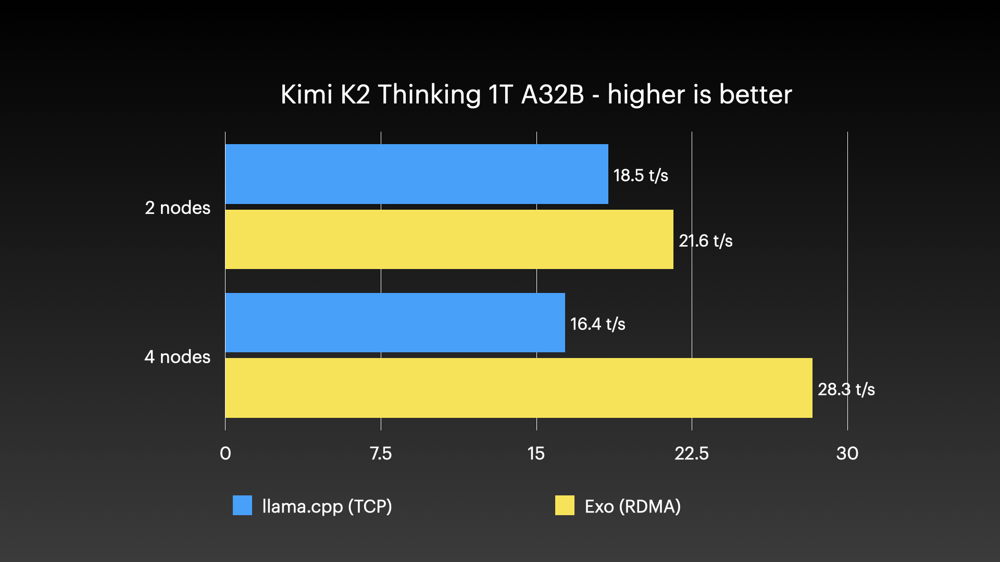
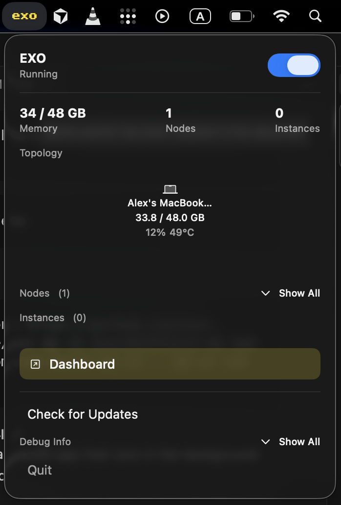

<div align="center">

<picture>
  <source media="(prefers-color-scheme: light)" srcset="/docs/imgs/exo-logo-black-bg.jpg">
  
</picture>

exo: Run frontier AI locally. Maintained by [exo labs](https://x.com/exolabs).

<p align="center">
  <a href="https://discord.gg/TJ4P57arEm" target="_blank" rel="noopener noreferrer"></a>
  <a href="https://x.com/exolabs" target="_blank" rel="noopener noreferrer"></a>
  <a href="https://www.apache.org/licenses/LICENSE-2.0.html" target="_blank" rel="noopener noreferrer"></a>
</p>

</div>

---

exo connects all your devices into an AI cluster. Not only does exo enable running models larger than would fit on a single device, but with [day-0 support for RDMA over Thunderbolt](https://x.com/exolabs/status/2001817749744476256?s=20), makes models run faster as you add more devices.

## Features

- **Automatic Device Discovery**: Devices running exo automatically discover each other - no manual configuration.
- **RDMA over Thunderbolt**: exo ships with [day-0 support for RDMA over Thunderbolt 5](https://x.com/exolabs/status/2001817749744476256?s=20), enabling 99% reduction in latency between devices.
- **Topology-Aware Auto Parallel**: exo figures out the best way to split your model across all available devices based on a realtime view of your device topology. It takes into account device resources and network latency/bandwidth between each link.
- **Tensor Parallelism**: exo supports sharding models, for up to 1.8x speedup on 2 devices and 3.2x speedup on 4 devices.
- **MLX Support**: exo uses [MLX](https://github.com/ml-explore/mlx) as an inference backend and [MLX distributed](https://ml-explore.github.io/mlx/build/html/usage/distributed.html) for distributed communication.
- **Multiple API Compatibility**: Compatible with OpenAI Chat Completions API, Claude Messages API, OpenAI Responses API, and Ollama API - use your existing tools and clients.
- **Custom Model Support**: Load custom models from HuggingFace hub to expand the range of available models.

## Dashboard

exo includes a built-in dashboard for managing your cluster and chatting with models.

<p align="center">
  
</p>
<p align="center"><em>4 × 512GB M3 Ultra Mac Studio running DeepSeek v3.1 (8-bit) and Kimi-K2-Thinking (4-bit)</em></p>

## Benchmarks

<details>
  <summary>Qwen3-235B (8-bit) on 4 × M3 Ultra Mac Studio with Tensor Parallel RDMA</summary>
  
  <p>
    <strong>Source:</strong> <a href="https://www.jeffgeerling.com/blog/2025/15-tb-vram-on-mac-studio-rdma-over-thunderbolt-5">Jeff Geerling: 15 TB VRAM on Mac Studio – RDMA over Thunderbolt 5</a>
  </p>
</details>

<details>
  <summary>DeepSeek v3.1 671B (8-bit) on 4 × M3 Ultra Mac Studio with Tensor Parallel RDMA</summary>
  
  <p>
    <strong>Source:</strong> <a href="https://www.jeffgeerling.com/blog/2025/15-tb-vram-on-mac-studio-rdma-over-thunderbolt-5">Jeff Geerling: 15 TB VRAM on Mac Studio – RDMA over Thunderbolt 5</a>
  </p>
</details>

<details>
  <summary>Kimi K2 Thinking (native 4-bit) on 4 × M3 Ultra Mac Studio with Tensor Parallel RDMA</summary>
  
  <p>
    <strong>Source:</strong> <a href="https://www.jeffgeerling.com/blog/2025/15-tb-vram-on-mac-studio-rdma-over-thunderbolt-5">Jeff Geerling: 15 TB VRAM on Mac Studio – RDMA over Thunderbolt 5</a>
  </p>
</details>

---

## Quick Start

Devices running exo find each other automatically, without any manual configuration, when they are on the same network and run the same version of exo (see [Adding another Mac](#adding-another-mac)). Each device provides an API and a dashboard for interacting with your cluster (runs at `http://localhost:52415`).

You can run exo with the macOS app, the easiest way on a Mac, or from source on macOS or Linux.

### macOS App

exo ships a macOS app that runs in the background, in your Mac's menu bar.



The app needs a Mac with Apple silicon and macOS Sequoia 15.1 or later. [RDMA over Thunderbolt](#enabling-rdma-on-macos) needs macOS Tahoe 26.2 or later.

Download the latest version: [EXO-latest.dmg](https://assets.exolabs.net/EXO-latest.dmg). Open it, drag EXO to your Applications folder, and open EXO from there. The first time, macOS asks whether you want to open an app downloaded from the internet: click **Open**.

You can also install it with Homebrew:

```bash
brew install --cask exo
```

#### What EXO asks for, and why

- **Local Network access.** macOS asks whether EXO may find devices on your local network. EXO needs this to find your other devices running exo and share the work with them. If you said no, turn EXO on in System Settings → Privacy & Security → Local Network, then quit and reopen EXO.
- **Thunderbolt network setup (optional, needs your administrator password).** EXO offers to set up networking for Thunderbolt in its menu when Macs are connected with Thunderbolt cables; you can also do it in Settings › Cluster. Macs that share a Wi-Fi or Ethernet network don't need it. If you agree, EXO installs a small system service (`io.exo.networksetup`) that:
  - creates a network location called `exo` and switches this Mac to it;
  - gives each Thunderbolt port its own network service, which gets an address automatically;
  - turns off Thunderbolt Bridge, which can flood the network with packets when three or more Macs are cabled in a loop.

  The service runs when your Mac starts and about every 30 minutes, to keep these settings in place. The `exo` location starts with default settings, so anything you changed in your usual location (such as a fixed IP address, DNS servers or proxies) doesn't apply while it's in use. To undo the setup, [uninstall EXO](#uninstalling-the-macos-app). To undo it but keep EXO, run the uninstall script described there: it restores your network settings and keeps your downloaded models, and EXO asks again before it sets up the network.
- **Opening at login.** EXO's welcome window has **Open EXO at login** ticked, so your Mac is ready to work with the others after a restart. Untick it there, or change it later in EXO's Settings › General or in System Settings → General → Login Items & Extensions.
- **Notifications.** EXO doesn't ask at launch. When an update is ready to install, it leaves a quiet notification in Notification Center; you can turn these off in System Settings → Notifications. You can always check for updates in EXO's menu or Settings.

#### Adding another Mac

1. Install EXO on the other Mac and open it.
2. Put both Macs on the same local network (Wi-Fi or Ethernet), or connect them with a Thunderbolt cable.
3. Make sure both Macs run the same version of exo. Devices running different versions don't join each other.

The new Mac shows up in the dashboard within a few seconds.

To see which version a Mac runs:

- in the app: choose **About EXO** from the menu bar icon, or open **Settings** › **General**;
- from source: run `uv run exo --version`.

The app and a source checkout number their versions differently. The app uses its release number (such as 1.0.71), while a source checkout uses the version in `pyproject.toml` (such as 0.3.70). Because the default [cluster name](#cluster-name) is the version, an app and a source checkout don't join each other by default. To mix them, give every device the same cluster name.

If a Mac doesn't show up:

- check that both Macs run the same version of exo;
- check that EXO is turned on in System Settings → Privacy & Security → Local Network on both Macs;
- guest Wi-Fi and some office networks stop devices from seeing each other: try Ethernet or a Thunderbolt cable instead;
- when exo sees another device that can't join (a different version or cluster name), it notes this in its log, `~/.exo/exo_log/exo.log`.

#### Updating

EXO checks for updates by itself and tells you when one is ready. You can also use **Check for Updates** in EXO's menu or Settings. A Homebrew installation updates itself the same way.

**Update every Mac in your cluster.** Devices running different versions of exo don't join each other, so a Mac you haven't updated yet drops out of the cluster until you update it too.

From source, pull the latest code, rebuild the dashboard and run `uv sync` again, on every device.

#### Cluster name

Devices join each other only when they use the same cluster name (in the CLI, the "namespace"). By default the cluster name is the exo version, which is why every device needs the same version.

To run separate clusters on one network, for example a test cluster next to your main one, give each cluster its own name:

- in the app: open **Settings** › **Cluster** from the menu bar icon and fill in **Cluster name** (leave it on Automatic for the default);
- from source: run `uv run exo --namespace my-cluster`, or set `EXO_ZENOH_NAMESPACE=my-cluster`.

A custom name replaces the version, so devices with the same custom name try to connect even when their versions differ. Keep them on the same version of exo. The cluster name in use is logged at startup ("Discovery namespace: …").

#### Uninstalling the macOS app

The easiest way is in the app: click the EXO icon in the menu bar, open **Settings** › **General**, and click **Uninstall EXO…**. Enter your administrator password when asked. EXO then:

- removes its network setup service and the `exo` network location, switches your Mac back to the Automatic location and turns Thunderbolt Bridge back on;
- removes its login item;
- deletes its data folder, `~/.exo`, but keeps downloaded models in `~/.exo/models` unless you untick **Keep downloaded models**;
- moves EXO.app to the Trash.

If you've already deleted EXO.app, or removed it with Homebrew, run the uninstall script. You don't need a copy of this repository:

```bash
curl -fsSLO https://raw.githubusercontent.com/exo-explore/exo/main/app/EXO/uninstall-exo.sh
sudo bash uninstall-exo.sh                   # keeps downloaded models
sudo bash uninstall-exo.sh --delete-models   # deletes them too
```

The script removes the network setup service, switches your Mac back to the Automatic location, turns Thunderbolt Bridge back on (recreating it if the network setup removed it), and deletes `~/.exo` except downloaded models. It can't remove the login item: if EXO is still listed in System Settings → General → Login Items & Extensions, remove it there.

What each way removes:

| Way | Network settings (if you agreed to the Thunderbolt setup) | `~/.exo` | Downloaded models (`~/.exo/models`) |
|---|---|---|---|
| **Uninstall EXO** in Settings | Service removed, back to the Automatic location, Thunderbolt Bridge back on | Deleted | Kept, unless you untick **Keep downloaded models** |
| `uninstall-exo.sh` | Service removed, back to the Automatic location, Thunderbolt Bridge back on | Deleted | Kept, unless you pass `--delete-models` |
| `brew uninstall --cask exo` | Service removed, but your Mac stays on the `exo` location with Thunderbolt Bridge off | Kept | Kept |
| `brew uninstall --zap --cask exo` | Same as `brew uninstall`. Also deletes the app's preferences and caches in `~/Library` | Kept (deleted only if empty) | Kept |
| Moving EXO.app to the Trash | The service removes itself within about 30 minutes, but your Mac stays on the `exo` location with Thunderbolt Bridge off | Kept | Kept |

After `brew uninstall` or moving EXO.app to the Trash, run the uninstall script to restore your network settings and remove `~/.exo`.

### Run from Source (macOS)

If you have [Nix](https://nixos.org/) installed, you can skip most of the steps below and run exo directly:

```bash
nix run .#exo
```

**Note:** To accept the Cachix binary cache (and avoid the Xcode Metal ToolChain), add these lines to `/etc/nix/nix.conf`, replacing `your-username` with your macOS username (`whoami` prints it):
```
trusted-users = root your-username
experimental-features = nix-command flakes
```
Then restart the Nix daemon: `sudo launchctl kickstart -k system/org.nixos.nix-daemon`

**Prerequisites:**
- [Xcode](https://developer.apple.com/xcode/) (provides the Metal ToolChain required for MLX compilation)
- [brew](https://github.com/Homebrew/brew) (for simple package management on macOS)

  ```bash
  /bin/bash -c "$(curl -fsSL https://raw.githubusercontent.com/Homebrew/install/HEAD/install.sh)"
  ```
- [uv](https://github.com/astral-sh/uv) (for Python dependency management)
- [node](https://github.com/nodejs/node) (for building the dashboard)

  ```bash
  brew install uv node
  ```
- [rust](https://github.com/rust-lang/rustup) (stable, to build the Rust bindings)

  ```bash
  curl --proto '=https' --tlsv1.2 -sSf https://sh.rustup.rs | sh
  ```
- [macmon](https://github.com/vladkens/macmon) (optional, for GPU usage, power and temperature monitoring on Apple Silicon; without it exo falls back to psutil and monitors memory only)

  Install the pinned fork revision used by this repo instead of Homebrew `macmon`.
  Homebrew `macmon 0.6.1` still crashes on Apple M5.

  ```bash
  cargo install --git https://github.com/vladkens/macmon \
    --rev a1cd06b6cc0d5e61db24fd8832e74cd992097a7d \
    macmon \
    --force
  ```

Clone the repo, build the dashboard, install the dependencies, and run exo:

```bash
# Clone exo
git clone https://github.com/exo-explore/exo

# Build dashboard
cd exo/dashboard && npm install && npm run build && cd ..

# Install Python dependencies, including the MLX backend
uv sync --extra mlx

# Run exo
uv run exo
```

This starts the exo dashboard and API at http://localhost:52415/


*Please view the section on RDMA to enable this feature on MacOS >=26.2!*


### Run from Source (Linux)

**Prerequisites:**

- [uv](https://github.com/astral-sh/uv) (for Python dependency management)
- [node](https://github.com/nodejs/node) (for building the dashboard) - version 18 or higher
- [rust](https://github.com/rust-lang/rustup) (stable, to build the Rust bindings)

**Installation methods:**

**Option 1: Using system package manager (Ubuntu/Debian example):**
```bash
# Install Node.js and npm
sudo apt update
sudo apt install nodejs npm

# Install uv
curl -LsSf https://astral.sh/uv/install.sh | sh

# Install Rust (using rustup)
curl --proto '=https' --tlsv1.2 -sSf https://sh.rustup.rs | sh
```

**Option 2: Using Homebrew on Linux (if preferred):**
```bash
# Install Homebrew on Linux
/bin/bash -c "$(curl -fsSL https://raw.githubusercontent.com/Homebrew/install/HEAD/install.sh)"

# Install dependencies
brew install uv node

# Install Rust (using rustup)
curl --proto '=https' --tlsv1.2 -sSf https://sh.rustup.rs | sh
```

**Note:** The `macmon` package is macOS-only and not required for Linux.

Clone the repo, build the dashboard, install the dependencies, and run exo:

```bash
# Clone exo
git clone https://github.com/exo-explore/exo

# Build dashboard
cd exo/dashboard && npm install && npm run build && cd ..

# Install Python dependencies with the MLX backend for your hardware
# (NVIDIA: --extra mlx-cuda13 or --extra mlx-cuda12)
uv sync --extra mlx-cpu

# Run exo
uv run exo
```

This starts the exo dashboard and API at http://localhost:52415/

**Important note for Linux users:** Currently, exo runs on CPU on Linux. GPU support for Linux platforms is under development. If you'd like to see support for your specific Linux hardware, please [search for existing feature requests](https://github.com/exo-explore/exo/issues) or create a new one.

**Configuration Options:**

- `--no-worker`: Run exo without the worker component. Useful for coordinator-only nodes that handle networking and orchestration but don't execute inference tasks. This is helpful for machines without sufficient GPU resources but with good network connectivity.

  ```bash
  uv run exo --no-worker
  ```

- `--legacy-daemon`: Run exo as a legacy SysV-style background daemon using double-fork daemonization. This is intended for legacy init scripts; systemd and launchd should run exo in the foreground without this flag.

  ```bash
  uv run exo --legacy-daemon
  ```

**File Locations (Linux):**

exo follows the [XDG Base Directory Specification](https://specifications.freedesktop.org/basedir-spec/basedir-spec-latest.html) on Linux:

- **Configuration files**: `~/.config/exo/` (or `$XDG_CONFIG_HOME/exo/`)
- **Data files**: `~/.local/share/exo/` (or `$XDG_DATA_HOME/exo/`)
- **Cache files**: `~/.cache/exo/` (or `$XDG_CACHE_HOME/exo/`)
- **Log files**: `~/.cache/exo/exo_log/` (with automatic log rotation)
- **Custom model cards**: `~/.local/share/exo/custom_model_cards/`

You can override these locations by setting the corresponding XDG environment variables.

---

### Enabling RDMA on macOS

RDMA is a new capability added to macOS 26.2. It works on any Mac with Thunderbolt 5 (M4 Pro Mac Mini, M4 Max Mac Studio, M4 Max MacBook Pro, M3 Ultra Mac Studio).

Please refer to the caveats for immediate troubleshooting.

To enable RDMA on macOS, follow these steps:

1. Shut down your Mac.
2. Hold down the power button for 10 seconds until the boot menu appears.
3. Select "Options" to enter Recovery mode.
4. When the Recovery UI appears, open the Terminal from the Utilities menu.
5. In the Terminal, type:
   ```
   rdma_ctl enable
   ```
   and press Enter.
6. Reboot your Mac.

After that, RDMA will be enabled in macOS and exo will take care of the rest.

**Important Caveats**

1. Devices that wish to be part of an RDMA cluster must be connected to all other devices in the cluster.
2. The cables must support TB5.
3. On a Mac Studio, you cannot use the Thunderbolt 5 port next to the Ethernet port.
4. If running from source, please use the script found at `tmp/set_rdma_network_config.sh`, which will disable Thunderbolt Bridge and set dhcp on each RDMA port.
5. RDMA ports may be unable to discover each other on different versions of MacOS. Please ensure that OS versions match exactly (even beta version numbers) on all devices.

---

## Environment Variables

exo supports several environment variables for configuration:

| Variable | Description | Default |
|----------|-------------|---------|
| `EXO_DEFAULT_MODELS_DIR` | Default directory for model downloads and caches. Always first in the writable dirs list. | `~/.local/share/exo/models` (Linux) or `~/.exo/models` (macOS) |
| `EXO_MODELS_DIRS` | Colon-separated additional writable directories for model downloads. Checked in order after the default; first with enough free space is used. | None |
| `EXO_MODELS_READ_ONLY_DIRS` | Colon-separated read-only directories to search for pre-downloaded models (e.g., NFS mounts, shared storage). Models here cannot be deleted. | None |
| `EXO_OFFLINE` | Run without internet connection (uses only local models) | `false` |
| `EXO_ENABLE_IMAGE_MODELS` | Enable image model support | `false` |
| `EXO_ZENOH_NAMESPACE` | Custom namespace for cluster isolation (same as `--namespace`) | exo version |
| `EXO_FAST_SYNCH` | Control MLX_METAL_FAST_SYNCH behavior (for JACCL backend) | Auto |
| `EXO_TRACING_ENABLED` | Enable distributed tracing for performance analysis | `false` |

**Example usage:**

```bash
# Use pre-downloaded models from NFS mount (read-only)
EXO_MODELS_READ_ONLY_DIRS=/mnt/nfs/models:/opt/ai-models uv run exo

# Download models to an external SSD (falls back to default dir if full)
EXO_MODELS_DIRS=/Volumes/ExternalSSD/exo-models uv run exo

# Run in offline mode
EXO_OFFLINE=true uv run exo

# Enable image models
EXO_ENABLE_IMAGE_MODELS=true uv run exo

# Use custom namespace for cluster isolation
EXO_ZENOH_NAMESPACE=my-dev-cluster uv run exo
```

---

### Using the API

exo provides multiple API-compatible interfaces for maximum compatibility with existing tools:

- **OpenAI Chat Completions API** - Compatible with OpenAI clients
- **Claude Messages API** - Compatible with Anthropic's Claude format
- **OpenAI Responses API** - Compatible with OpenAI's Responses format
- **Ollama API** - Compatible with Ollama and tools like OpenWebUI

If you prefer to interact with exo via the API, here is an example creating an instance of a small model (`mlx-community/Llama-3.2-1B-Instruct-4bit`), sending a chat completions request and deleting the instance.

---

**1. Preview instance placements**

The `/instance/previews` endpoint will preview all valid placements for your model.

```bash
curl "http://localhost:52415/instance/previews?model_id=mlx-community/Llama-3.2-1B-Instruct-4bit"
```

Sample response:

```json
{
  "previews": [
    {
      "model_id": "mlx-community/Llama-3.2-1B-Instruct-4bit",
      "sharding": "Pipeline",
      "instance_meta": "MlxRing",
      "instance": {...},
      "memory_delta_by_node": {"local": 729808896},
      "error": null
    }
    // ...possibly more placements...
  ]
}
```

This will return all valid placements for this model. Pick a placement that you like.
To pick the first one, pipe into `jq`:

```bash
curl "http://localhost:52415/instance/previews?model_id=mlx-community/Llama-3.2-1B-Instruct-4bit" | jq -c '.previews[] | select(.error == null) | .instance' | head -n1
```

---

**2. Create a model instance**

Send a POST to `/instance` with your desired placement in the `instance` field (the full payload must match types as in `CreateInstanceParams`), which you can copy from step 1:

```bash
curl -X POST http://localhost:52415/instance \
  -H 'Content-Type: application/json' \
  -d '{
    "instance": {...}
  }'
```


Sample response:

```json
{
  "message": "Command received.",
  "command_id": "e9d1a8ab-...."
}
```

This command is asynchronous. Before sending inference requests, wait until the
API sees the new instance for this model:

```bash
curl -N "http://localhost:52415/instance/await?model_id=mlx-community/Llama-3.2-1B-Instruct-4bit"
```

The endpoint returns an SSE stream. A successful wait emits a message with
`"type": "ready"` and the matching instance; a timeout emits `"type": "timeout"`.
By default it waits indefinitely. Set `timeout_seconds` to a positive value to
bound the wait.

---

**3. Send a chat completion**

Now, make a POST to `/v1/chat/completions` (the same format as OpenAI's API):

```bash
curl -N -X POST http://localhost:52415/v1/chat/completions \
  -H 'Content-Type: application/json' \
  -d '{
    "model": "mlx-community/Llama-3.2-1B-Instruct-4bit",
    "messages": [
      {"role": "user", "content": "What is Llama 3.2 1B?"}
    ],
    "stream": true
  }'
```

---

**4. Delete the instance**

When you're done, delete the instance by its ID (find it via `/state` or `/instance` endpoints):

```bash
curl -X DELETE http://localhost:52415/instance/YOUR_INSTANCE_ID
```

### Claude Messages API Compatibility

Use the Claude Messages API format with the `/v1/messages` endpoint:

```bash
curl -N -X POST http://localhost:52415/v1/messages \
  -H 'Content-Type: application/json' \
  -d '{
    "model": "mlx-community/Llama-3.2-1B-Instruct-4bit",
    "messages": [
      {"role": "user", "content": "Hello"}
    ],
    "max_tokens": 1024,
    "stream": true
  }'
```

### OpenAI Responses API Compatibility

Use the OpenAI Responses API format with the `/v1/responses` endpoint:

```bash
curl -N -X POST http://localhost:52415/v1/responses \
  -H 'Content-Type: application/json' \
  -d '{
    "model": "mlx-community/Llama-3.2-1B-Instruct-4bit",
    "input": "Hello",
    "stream": true
  }'
```

### Ollama API Compatibility

exo supports Ollama API endpoints for compatibility with tools like OpenWebUI:

```bash
# Ollama chat
curl -X POST http://localhost:52415/ollama/api/chat \
  -H 'Content-Type: application/json' \
  -d '{
    "model": "mlx-community/Llama-3.2-1B-Instruct-4bit",
    "messages": [
      {"role": "user", "content": "Hello"}
    ],
    "stream": false
  }'

# List models (Ollama format)
curl http://localhost:52415/ollama/api/tags
```

### Custom Model Loading from HuggingFace

You can add custom models from the HuggingFace hub:

```bash
curl -X POST http://localhost:52415/models/add \
  -H 'Content-Type: application/json' \
  -d '{
    "model_id": "mlx-community/my-custom-model"
  }'
```

**Security Note:**

Custom models requiring `trust_remote_code` in their configuration must be explicitly enabled (default is false) for security. Only enable this if you trust the model's remote code execution. Models are fetched from HuggingFace and stored locally as custom model cards.

**Other useful API endpoints*:**

- List all models: `curl http://localhost:52415/models`
- List downloaded models only: `curl http://localhost:52415/models?status=downloaded`
- Search HuggingFace: `curl "http://localhost:52415/models/search?query=llama&limit=10"`
- Inspect instance IDs and deployment state: `curl http://localhost:52415/state`

For further details, see:

- API documentation in [docs/api.md](docs/api.md).
- API endpoints in [src/exo/api/main.py](src/exo/api/main.py), and their request and response types in [src/exo/api/types/](src/exo/api/types/).

---

## Benchmarking

The `exo-bench` tool measures model prefill and token generation speed across different placement configurations. This helps you optimize model performance and validate improvements.

**Prerequisites:**
- Nodes should be running with `uv run exo` before benchmarking
- The tool uses the `/bench/chat/completions` endpoint

**Basic usage:**

```bash
uv run bench/exo_bench.py \
  --model Llama-3.2-1B-Instruct-4bit \
  --pp 128,256,512 \
  --tg 128,256
```

**Key parameters:**

- `--model`: Model to benchmark (short ID or HuggingFace ID)
- `--pp`: Prompt size hints (comma-separated integers)
- `--tg`: Generation lengths (comma-separated integers)
- `--max-nodes`: Limit placements to N nodes (default: 4)
- `--instance-meta`: Filter by `ring`, `jaccl`, or `both` (default: both)
- `--sharding`: Filter by `pipeline`, `tensor`, or `both` (default: both)
- `--repeat`: Number of repetitions per configuration (default: 1)
- `--warmup`: Warmup runs per placement (default: 0)
- `--json-out`: Output file for results (default: bench/results.json)

**Example with filters:**

```bash
uv run bench/exo_bench.py \
  --model Llama-3.2-1B-Instruct-4bit \
  --pp 128,512 \
  --tg 128 \
  --max-nodes 2 \
  --sharding tensor \
  --repeat 3 \
  --json-out my-results.json
```

The tool outputs performance metrics including prompt tokens per second (prompt_tps), generation tokens per second (generation_tps), and peak memory usage for each configuration.

---

## Hardware Accelerator Support

On macOS, exo uses the GPU. On Linux, exo currently runs on CPU. We are working on extending hardware accelerator support. If you'd like support for a new hardware platform, please [search for an existing feature request](https://github.com/exo-explore/exo/issues) and add a thumbs up so we know what hardware is important to the community.

---

## Contributing

See [CONTRIBUTING.md](CONTRIBUTING.md) for guidelines on how to contribute to exo.
